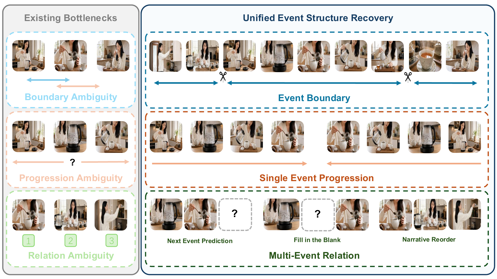
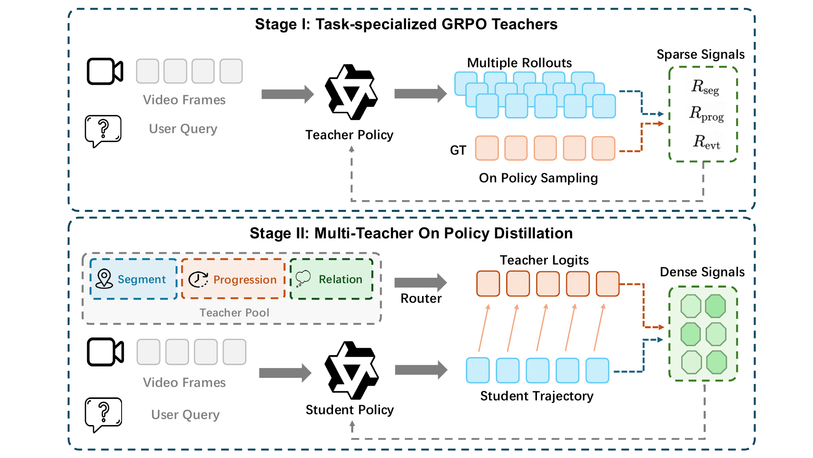
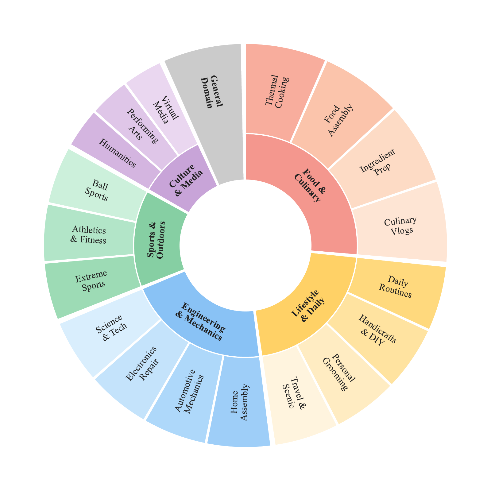
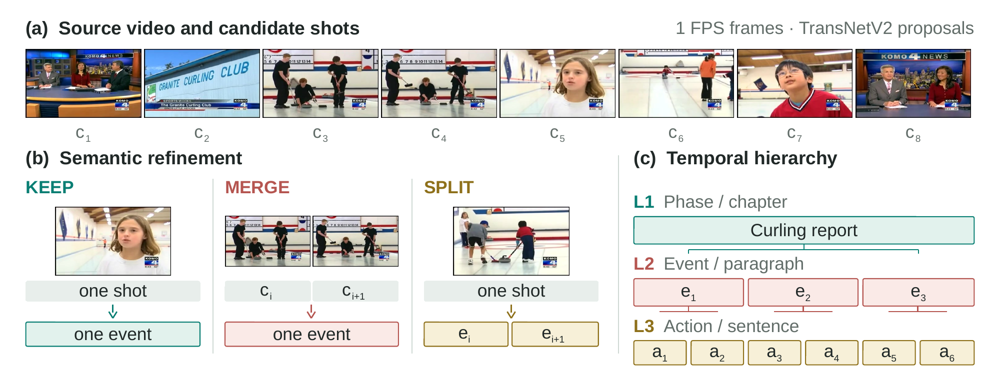

<div align="center">

# EventLens

### Event-Structure Reinforcement Learning<br>for Video Understanding

Guowen Zhang<sup>1</sup> · Boshen Xu<sup>1</sup> · Zihao Yue<sup>1</sup> · Ziheng Wang<sup>1</sup><br>
Xiaokun Liu<sup>2</sup> · Xin Tao<sup>2</sup> · Wenyu Qin<sup>2</sup> · Pengfei Wan<sup>2</sup> · Qin Jin<sup>1</sup>

<sup>1</sup>AIM3 Lab, Renmin University of China &nbsp;&nbsp; <sup>2</sup>Kling AI

**[Project Page](https://lostgreen.github.io/EventLens/) · [Paper](https://arxiv.org/abs/2610.16172) · [Dataset](https://huggingface.co/datasets/Lostgreen/EventLens-Train) · [4B Model](https://huggingface.co/Lostgreen/EventLens-4B) · [8B Model](https://huggingface.co/Lostgreen/EventLens-8B)**

**[🧠 Method](#method) &nbsp; | &nbsp; [📊 Results](#results) &nbsp; | &nbsp; [🔍 Training Data](#training-data) &nbsp; | &nbsp; [📐 Setup](#setup) &nbsp; | &nbsp; [🚀 Training](#training)**

</div>

EventLens learns **event boundaries, progression, and relations** from visual
evidence. Three specialist teachers learn through reinforcement learning with
verifiable rewards; **multi-teacher on-policy distillation (MT-OPD)** consolidates
their skills into one video model.



<a id="results"></a>

## 📊 Results

Selected temporal grounding and event-sensitive reasoning results from the paper,
compared with the corresponding pretrained backbone:

| Model | QVHighlights | ActivityNet | Charades-STA | E.T. Bench | VinoGround |
| :--- | ---: | ---: | ---: | ---: | ---: |
| Qwen3-VL-4B | 54.31 | 41.99 | 43.64 | 34.55 | 37.00 |
| **EventLens-4B** | **58.50** | **45.76** | **47.99** | **41.47** | **45.00** |
| Qwen3-VL-8B | 50.03 | 39.96 | 44.79 | 32.77 | 40.20 |
| **EventLens-8B** | **59.12** | **46.35** | **48.25** | **38.40** | **47.20** |

*Shared 256-frame protocol. Temporal grounding uses mIoU; E.T. Bench and
VinoGround use official benchmark scores. Higher is better; bold marks the
best score within each base-model/EventLens pair.*

<a id="method"></a>

## 🧠 Method



**Stage I: Train specialists.** Three 4B teachers learn event segmentation,
single-event progression, and multi-event relations with task-specific rewards.

**Stage II: Distill a unified model.** A 4B or 8B student generates responses;
the matching specialist supplies token distributions for on-policy distillation.
Both student sizes use the same three teachers.

Built on **EasyR1 and verl**, with task-normalized EMA-GRPO, multi-teacher
routing, and on-policy distillation.

### Code Layout

| Directory | Purpose |
| --- | --- |
| [`EasyR1/configs/`](EasyR1/configs) | Teacher and student training recipes |
| [`EasyR1/video_proxy/`](EasyR1/video_proxy) | Data construction and training launchers |
| [`EasyR1/verl/`](EasyR1/verl) | Training engine and task rewards |
| [`huggingface/`](huggingface) | Dataset schema and release templates |

<a id="training-data"></a>

## 🔍 Training Data

EventLens constructs three recovery tasks from the training partitions of
TimeLens-100K and ET-Instruct-164K:
**event boundaries, single-event progression, and multi-event relations**.
Temporal-grounding and video-QA examples complement these tasks during training.

| Task | What The Model Learns | Dataset View |
| --- | --- | --- |
| Event boundaries | Recover event segments and their temporal boundaries | `seg` |
| Single-event progression | Recognize how an event unfolds over time | `prog` |
| Multi-event relations | Recover relations and ordering between events | `relation` |
| Temporal grounding | Locate the video interval described by a query | `tg` |
| Video QA | Answer multiple-choice questions about video content | `mcq` |

The appendix figure below shows the domain composition of the source videos
used to construct the recovery tasks.

<div align="center">

</div>

<details>
<summary><b>Event structure and annotation</b></summary>



Candidate shots are refined with KEEP, MERGE, and SPLIT into phases, events,
and actions. The figure illustrates the construction process; boundaries and
event assignments are schematic.

</details>

The [training dataset](https://huggingface.co/datasets/Lostgreen/EventLens-Train),
[EventLens-4B](https://huggingface.co/Lostgreen/EventLens-4B), and
[EventLens-8B](https://huggingface.co/Lostgreen/EventLens-8B) are available.
Specialist teacher checkpoints are not released; the recipes below train them
from Qwen3-VL-4B-Instruct.

<a id="setup"></a>

## 📐 Setup

Use Linux with NVIDIA GPUs and a compatible CUDA/PyTorch stack. Create a
Python 3.11 environment and install the training module:

```bash
conda create -n eventlens python=3.11 -y
conda activate eventlens
git clone https://github.com/lostgreen/EventLens.git
cd EventLens/EasyR1
python -m pip install -e .
python -m pip install -r ../huggingface/requirements.txt
```

Dependencies include vLLM, FlashAttention, Ray, and
`transformers>=4.54.0,<=4.57.0`. OmegaConf is constrained to `>=2.3,<2.4`
for compatibility with the configuration schema. Recipes default to one node with eight GPUs;
adjust GPU and batch settings for your hardware with `--set KEY=VALUE`.

<a id="training"></a>

## 🚀 Training

The workflow is **download data → train three teachers → export checkpoints
→ train a 4B or 8B student with MT-OPD**. Run training commands from `EasyR1/`.

### 1. Load And Prepare The Data

The Hugging Face release provides Parquet views for inspection and portable
JSONL mixes for training. Download it and unpack the shared frame shards:

```python
from datasets import load_dataset
from huggingface_hub import snapshot_download

dataset_id = "Lostgreen/EventLens-Train"
data = load_dataset(dataset_id, "paper_mt_opd")
train, monitor = data["train"], data["monitor_val"]

snapshot_download(
    repo_id=dataset_id,
    repo_type="dataset",
    local_dir="/path/to/eventlens-data",
)
```

Choose `paper_seg_teacher`, `paper_prog_teacher`, or
`paper_relation_teacher` to inspect a teacher's training mix; `paper_mt_opd`
contains all five tasks for the student. `monitor_val` is the training monitor.

The `monitor_val` split preserves the historical training monitor and overlaps
with training; it is not an independent validation or test split.

```bash
DATASET_ROOT=/path/to/eventlens-data
for shard in "$DATASET_ROOT"/media/shards/*.tar; do
  tar -xf "$shard" -C "$DATASET_ROOT"
done

for view in paper_seg_teacher paper_prog_teacher paper_relation_teacher paper_mt_opd; do
  mkdir -p "$DATASET_ROOT/runtime/$view"
  gzip -dc "$DATASET_ROOT/train/$view/training.jsonl.gz" > "$DATASET_ROOT/runtime/$view/train.jsonl"
  gzip -dc "$DATASET_ROOT/val/$view/training.jsonl.gz" > "$DATASET_ROOT/runtime/$view/val.jsonl"
done
```

Pass these files with `--train-file` and `--val-file`, and set `--media-root`
to the dataset root. The examples below use this portable layout. Preserve the
provided `messages`, `data_type`, video grouping, frame order, and timing
metadata. The dataset also includes `tools/convert_to_training_jsonl.py` for
converting Parquet views; see its
[dataset card](https://huggingface.co/datasets/Lostgreen/EventLens-Train#use-with-the-training-code).

### 2. Train The Teachers

Each teacher starts from **Qwen3-VL-4B-Instruct** and trains with one event
recovery task together with temporal-grounding and video-QA data.

| Teacher | Task Argument | OPD Teacher Name |
| --- | --- | --- |
| Boundary | `seg` | `seg` |
| Progression | `prog` | `aot` |
| Relation | `relation` | `eventlogic` |

```bash
bash video_proxy/experiments/teacher_train/run.sh seg paper \
  --train-file "$DATASET_ROOT/runtime/paper_seg_teacher/train.jsonl" \
  --val-file "$DATASET_ROOT/runtime/paper_seg_teacher/val.jsonl" \
  --media-root "$DATASET_ROOT" \
  --output-dir /path/to/runs/seg-teacher --dry-run
```

Use `prog` with `paper_prog_teacher` files, or `relation` with
`paper_relation_teacher` files, for the other teachers. `--dry-run` validates the
configuration and inputs; remove it to start training.

### 3. Export The Teachers

Merge each teacher's saved actor checkpoint into Hugging Face format:

```bash
python scripts/model_merger.py \
  --local_dir /path/to/teacher-checkpoint/actor \
  --base_model Qwen/Qwen3-VL-4B-Instruct
```

The result is written to `/path/to/teacher-checkpoint/actor/huggingface/`.
Repeat for all three teachers and use these exported directories below.

### 4. Train The Student With MT-OPD

The student starts from **Qwen3-VL-4B-Instruct** or **Qwen3-VL-8B-Instruct**.
It generates responses on the combined training mix, and the matching teacher
guides each task. Both student sizes use the same three 4B teachers.

```bash
bash video_proxy/experiments/opd/run.sh 8b \
  --train-file "$DATASET_ROOT/runtime/paper_mt_opd/train.jsonl" \
  --val-file "$DATASET_ROOT/runtime/paper_mt_opd/val.jsonl" \
  --media-root "$DATASET_ROOT" \
  --teacher aot=/path/to/prog-teacher-hf \
  --teacher seg=/path/to/seg-teacher-hf \
  --teacher eventlogic=/path/to/relation-teacher-hf \
  --output-dir /path/to/runs/student-8b --dry-run
```

Use `4b` for the smaller student. Remove `--dry-run` to start distillation.

**Prompt modes.** The paper recipes use **no-CoT**. The same engine also
supports optional CoT teacher training through [`configs/cot/`](EasyR1/configs/cot).
Use a matching CoT-prompted dataset and replace `paper` with `cot` in the
teacher command.

## 📄 License

Code is licensed under [Apache-2.0](LICENSE), with upstream attribution in
[NOTICE](NOTICE). Paper figures, datasets, and models retain their respective
terms; see the [source registry](manifests/sources.yaml) and
[figure sources](assets/figures/README.md).

## Project Website

The [project page](https://lostgreen.github.io/EventLens/) is served from
`index.html` and `static/` using GitHub Pages on `main`. To preview it locally,
run `python3 -m http.server 8000` from the repository root. Keep `.nojekyll`
in the root. The website layout is adapted from the Academic Project Page
Template and Nerfies under CC BY-SA 4.0; see
[THIRD_PARTY_NOTICES.md](THIRD_PARTY_NOTICES.md) for website attribution.
